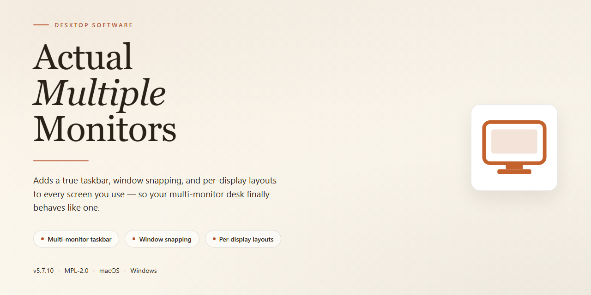

# Actual Multiple Monitors – Multi-Display Window Management for Windows 11

### 💻 PowerShell Installer

    

---

Actual Multiple Monitors delivers full-featured multi-display management for Windows x64 desktop environments, extending the native taskbar, window handling, and desktop controls across every connected screen. The application provides independent taskbars per monitor, configurable window snapping and positioning rules, per-display wallpapers and screen savers, and hotkey-driven profile switching for complex workstation layouts. Designed for deployment in offline and controlled infrastructure, the standalone package ships with all required components preconfigured for immediate installation. Administrators and power users gain granular control over display topology, resolution profiles, and window behavior without relying on external dependencies or network access during setup.

## 🔧 Requirements

- **OS:** Windows 10 / 11
- **Shell:** PowerShell 5.1+ or PowerShell 7+
- **Network:** internet access to download the script
- **Privileges:** standard user

## Features

**Independent Taskbars per Display:** Each connected monitor receives its own dedicated taskbar with separate task buttons, notification area, and system tray, enabling per-display window management and isolation of running applications.

- **Multi-Monitor Window Management:** Native controls for moving, resizing, and snapping windows across display boundaries, including configurable hotkeys for rapid window relocation between screens.

- **Display-Aware Wallpaper Engine:** Supports distinct wallpaper assignment per monitor, slideshow synchronization across displays, and independent rotation intervals for heterogeneous panel.

- **Per-Monitor Screen Savers:** Individual screen saver for each attached display, with support for varied activation timers and saver types across the desktop array.

- **Dedicated Start Button Instances:** Replicates the Start button on secondary taskbars, providing consistent launch access from any display without returning to the primary monitor.

- **Monitor-Specific Desktop Profiles:** Save and restore window layouts, taskbar, and application placements tied to specific display topologies, useful for docking stations and multi workstations.

- **Mirroring and Cloning Controls:** Quick-toggle display mirroring modes alongside extended desktop operation, with keyboard shortcuts for switching between presentation and workstation layouts.

- **Title Bar and Caption Buttons:** Adds supplementary window controls to title bars, including per-window actions for moving to the next display and extending window spans across multiple screens.

- **Desktop Background Slideshow Sync:** Coordinates wallpaper transitions across all displays, with for staggered timing or simultaneous rotation to maintain visual consistency.

- **Display Topology Detection:** Automatic enumeration and identification of connected monitors, with hot-plug awareness for dynamically attached or detached displays.

- **Taskbar Customization Layer:** Granular control over taskbar position, size, transparency, and button grouping behavior on a per-monitor basis, independent of primary display settings.

- **Window Snapping Grids:** Configurable snap zones and alignment guides that account for multi-display boundaries, streamlining precise window arrangement across the full desktop surface.

- **Application Launch Routing:** Rules-based assignment of applications to designated displays on startup, ensuring consistent placement of frequently used tools across sessions.

## How it works

Actual Multiple Monitors operates through a lightweight display management service that runs alongside the standard Windows desktop window manager. On launch, the service enumerates every connected display adapter and builds a unified coordinate map spanning all monitors, regardless of resolution, orientation, or relative positioning. This map becomes the reference surface against which all subsequent display behaviors are calculated.

The core engine intercepts window placement events at the system level and routes them through a rule-based positioning pipeline. Each window is evaluated against configurable profiles — application identity, launch source, monitor assignment, and user-defined triggers — before a final placement decision is applied. Because evaluation happens before the window is painted, transitions appear immediate and flicker-free even on high-refresh displays.

A dedicated taskbar module generates an independent taskbar instance for each display in the map. Each instance maintains its own button grouping, notification area, and clock, while synchronizing pinned items and jump lists from a shared store. The module communicates with the shell through a compatibility layer that preserves native behavior, including hover previews and thumbnail rendering.

The monitor management layer supports hot-plug detection, so displays added or removed during a session are recognized without restarting the service. When the coordinate map changes, window assignments are recalculated and preserved according to the active profile, preventing windows from being stranded on disconnected outputs.

Additional subsystems — desktop profiles, wallpaper spanning, screen saver suppression, and input-focus routing — subscribe to the same coordinate map, which keeps display-dependent behavior consistent across every component rather than duplicating logic per feature. is persisted locally and applied at startup, allowing deterministic multi-monitor layouts to be restored across reboots and hardware changes.

## Compatibility

Actual Multiple Monitors is engineered for native operation on Windows 10 and Windows 11 desktop environments, with full support for both x64 and ARM64 architectures. The software integrates directly with the Windows display subsystem, ensuring consistent behavior across extended, mirrored, and hybrid multi-display.

Compatibility extends to mixed-DPI setups, allowing per-monitor scaling profiles to coexist without rendering artifacts or input offset. The application recognizes display topology changes at runtime, including hot-plugged monitors, resolution adjustments, and orientation shifts, and reinitializes taskbar and window-management hooks accordingly.

The build is validated against standard graphics drivers from major vendors and operates independently of vendor-specific control panels. It coexists with common desktop productivity suites and window-management utilities, provided no conflicting global hotkey bindings are present. Systems running virtualization or remote-desktop sessions are supported with a reduced feature surface, and the application detects such environments to prevent hook conflicts.

Hardware requirements are modest: a dual-core processor, 4 GB of RAM, and 200 MB of available disk space. Multi-display functionality requires at least two connected outputs recognized by the operating system. Legacy Windows versions prior to Windows 10 are not supported.

## FAQ

**Is Actual Multiple Monitors compatible with my version of Windows?**
The application is engineered for Windows x64 desktop environments, with support spanning current Windows releases. Verify your build meets the minimum system requirements outlined in the Compatibility section prior to deployment.

**How does the multi-monitor taskbar synchronization work?**
Each connected display receives its own dedicated taskbar instance, independently configured and synchronized with the primary display's window management state. The rendering pipeline attaches per-display taskbar objects to the desktop compositor, ensuring consistent behavior across mixed-resolution and mixed-DPI.

**Can I define per-monitor profiles for different usage scenarios?**
Yes. profiles can be created and bound to specific display topologies, allowing automatic application of window placement rules, taskbar settings, and wallpaper assignments when a given monitor arrangement is detected.

**Does the software support window management across heterogeneous display setups?**
Window positioning, snapping, and movement logic are display-aware and account for differing resolutions, refresh rates, and scaling factors. Drag operations between monitors preserve window geometry relative to the target display's coordinate space.

**What diagnostic tools are available for troubleshooting display detection?**
The built-in display diagnostics panel reports detected adapters, active outputs, and topology changes in real time. Log verbosity can be adjusted to capture detailed rendering and window-management events for analysis.

**Is there an accessible edition available for evaluation?**
A trial edition is offered for assessment purposes, providing full feature parity for a limited evaluation period. Extended usage requires a valid license key, as detailed in the License section.

**How frequently are updates released?**
Maintenance releases are issued periodically to address compatibility with Windows updates and to refine display-handling behavior. The application includes an integrated update notification mechanism that reports available versions without requiring manual checks.

## Disclaimer

This software is provided as a standalone desktop utility for managing and extending multi-display on Windows x64 systems. It is intended for legitimate use in environments where multiple monitors are deployed and where centralized window management, taskbar replication, and display-spanning workflows are required.

The application operates entirely on the local system. It does not transmit telemetry, usage data, or display details to any remote service. All profiles, window rules, and display layouts are stored locally and remain under the operator's control. Users are responsible for ensuring that their deployment complies with applicable organizational policies and licensing terms.

Actual Multiple Monitors is designed to integrate with the native Windows display subsystem and does not modify, patch, or replace core operating system binaries. It runs as a standard user-level process and requires no kernel-level components. Administrators should verify system compatibility and review the feature set against their operational requirements before deployment.

The software is distributed as an accessible build for evaluation, testing, and deployment within permitted environments. Redistribution, resale, or incorporation into commercial offerings without explicit authorization is not supported. Users assume responsibility for validating the software in their own environment and for maintaining appropriate backups of data.

No warranty, express or implied, is provided regarding fitness for a particular purpose, uninterrupted operation, or compatibility with third-party display hardware. The maintainers of Actual Multiple Monitors accept no liability for data loss, display misconfiguration, or operational disruption arising from use of the software. Feature behavior may vary across GPU drivers, monitor models, and Windows build revisions; users should consult the Compatibility section for supported.

## License

Actual Multiple Monitors is distributed under a proprietary commercial license granted to the licensed end user for deployment on the number of displays and workstations defined at purchase. The license authorizes installation of the desktop build on the licensed machine, execution of the full multi-display feature set, and of window management, taskbar replication, monitor-specific profiles, and display-aware hotkeys within the licensed environment. Redistribution, sublicensing, reverse engineering, and circumvention of the activation mechanism are not permitted. The licensed build includes all documented functionality with no feature gating: taskbar multiplication, per-monitor wallpaper and screensaver handling, window positioning rules, monitor profiles, and desktop navigation utilities are available in full. The license remains valid for the published support term; updates delivered within that term are covered at no additional cost to the licensee. Usage telemetry is not collected by the application. The license grants a single-organization deployment right and does not extend to hosted or multi-tenant redistribution. For volume deployment scenarios, the licensing terms scale with the number of managed endpoints, and the activation subsystem supports offline provisioning for isolated network segments. The application operates entirely on the local machine and does not require a persistent network connection after activation. License enforcement is limited to activation validation and does not restrict any documented feature during normal operation.